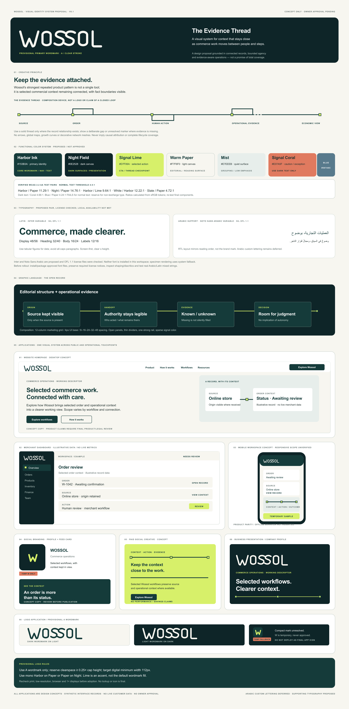

# وُسول — مقترح نظام الهوية البصرية الكامل V0.1

**الحالة: قيد المراجعة — مقترح مهني للمالك، وليس هوية معتمدة.**

## ما أُنجز فعليًا

أُنتجت لوحة واحدة قابلة للتحرير بصيغة SVG، ورُندرت إلى PNG بعد فحص بصري وتصحيح عيوب ظهرت في النسخة الأولى. تبني اللوحة على مسار الشعار اللاتيني A / Clear Stroke الموجود مسبقًا، من دون إنشاء جولات جديدة للشعار. وتعرض:

- نظامًا رسوميًا مقترحًا بعنوان «خيط الدليل / السجل المفتوح»: خط يربط السياق بالفعل والأدلة المتاحة، وينقطع أو يصبح متقطعًا حين تكون العلاقة غير مؤكدة؛ ليس شعارًا ولا ادعاءً بدورة مكتملة.
- لوحة ألوان بأدوار محددة وفحوص تباين أولية، مع التحذير من استخدام الأزرق كنص عادي فوق الورق.
- Inter للنص اللاتيني وNoto Sans Arabic للنص العربي المساند، مع بيان واضح بأن الخطين لم يكونا مثبتين محليًا وقت الرندر؛ لذلك تستخدم صورة المعاينة خط النظام البديل ولا تمثل عينة دقيقة منهما.
- تطبيقات تصورية لموقع، ولوحة تشغيل، وشاشة جوال، ومنشورات اجتماعية، وإعلان، وملف تعريفي للشركة. كل بيانات الواجهات والنصوص اصطناعية للعرض، وليست بيانات حقيقية أو تأكيدًا لتوافر مزايا المنتج.
- عرض استخدام الشعار على خلفيات فاتحة وداكنة. علامة W الظاهرة بديل مؤقت فقط، ولا تُعتمد كأيقونة أو شعار مستقل.

## التوصية وحدودها

أوصي بعرض مسار A بوصفه الكلمة اللاتينية الأساسية المؤقتة للمراجعة، لا بوصفه اختيارًا نهائيًا. وضوحه مناسب للعرض، لكن تميّزه الخاص ما زال محدودًا، ولا توجد علامة مختصرة مستقلة نجحت في تجاوز بوابة المراجعة. الأفضل عدم اختراع أيقونة شكلية لمجرد ملء موضع التطبيق؛ استخدموا عنصرًا محايدًا مؤقتًا حتى يقرر المالك إن كانت العلامة المستقلة مطلوبة.

اللوحة اقتراح مكتبي وليست اختبارًا مع التجار. لم تُجرَ مراجعة من قارئ عربي أصلي أو مختص وصول رقمي، ولم تُختبر الخطوط المقترحة بعد تثبيتها، ولا تثبت نماذج الواجهات تكافؤ تطبيق الجوال مع المنتج الحالي. يجب كذلك إتمام فحص العلامة التجارية والنسخ التسويقية قبل النشر. الخط العربي المخصص مؤجل، لا مرفوض ولا معتمد.

## المطلوب من المالك

اعتماد أو رفض اتجاه A للمواصلة؛ مراجعة الألوان ومبدأ «خيط الدليل»؛ تحديد الحاجة إلى علامة مختصرة؛ الموافقة على نظام الخطوط المقترح بعد معاينة النسخ المثبتة؛ ومراجعة النصوص والتطبيقات التصورية. لا يُعد هذا التقرير موافقة نهائية على أي عنصر.

## الملفات

- [لوحة الهوية القابلة للتحرير SVG](WOSSOL_COMPLETE_VISUAL_IDENTITY_SYSTEM_V0.1.svg)
- [معاينة اللوحة PNG](WOSSOL_COMPLETE_VISUAL_IDENTITY_SYSTEM_V0.1.png)
- [دليل الاستخدام V0.1](VISUAL_IDENTITY_GUIDELINES_V0.1.md)
- [قرار الشعار اللاتيني والعلامة المختصرة السابق](../logo/PRIMARY_LATIN_WORDMARK_AND_COMPACT_MARK_REVIEW_V0.1.md)
